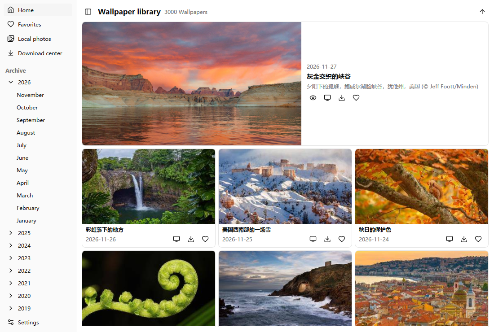

# Bing Daily Wallpaper Library

**English** · [简体中文](README.zh-CN.md)

Browse daily Bing photography by year and month, keep favorites, and set a photo on your desktop. This development branch uses NSH 0.7.2 for its interface and Rust for its archive, downloads and desktop integration.

## Try the desktop build

| Platform | Development artifact | Runtime |
| --- | --- | --- |
| Windows x64 | `BingWallpaperLib-v0.3.0-windows-x64.exe` | One portable file. The target is Windows 10 1809 or newer. Windows 11 has been exercised. |
| Linux x86_64 | `BingWallpaperLib-v0.3.0-linux-x86_64.AppImage` | GTK 4.14+ and WebKitGTK 6.0. Make the AppImage executable before starting it. |

The desktop rewrite is undergoing local testing. The maintainer signs the final Windows executable before public distribution. [Build and test plan](desktop/README.md) · [Validation records](desktop/VALIDATION.md)

Windows 0.2.37 is available for older systems. [GitCode](https://gitcode.com/gcw_qWIjmve7/bing-wallpaper-lib/releases/v0.2.37) · [GitHub](https://github.com/pandaligx/bing-wallpaper-lib/releases/tag/v0.2.37)

## Using the library

- Open the latest photo or expand a year to visit a month. The offline catalog stays available while the application checks for new entries every 30 minutes. Previews use 1080p and support arrow keys and Escape.
- Favorite a date, or choose original UHD, 4K, 2K or 1K for saving and setting wallpaper. The download center handles all history, one month, favorites or a calendar range. It shows progress, transfer speed, reused files and retryable failures.
- The local gallery scans the selected folder and can preview, apply or delete completed photos. A deletion dialog shows the selection count.
- Settings include six interface languages, system/light/dark appearance, download location, login startup, tray behavior and monitor selection. Windows and Plasma support individual screens. GNOME applies the background to the desktop. Other Linux desktops use the available wallpaper portal.
- Set a daily change time or a repeating interval of 1–1439 minutes. The repeating task can select the latest image on its first successful run each day and then draw from history or favorites.

## Migration and updates

Install the first NSH Windows build manually. Its new filename keeps it separate from the 0.2.37 updater. On first use it reads the existing `%LOCALAPPDATA%\BingWallpaperLib` profile. Configuration changes save the original bytes in `settings.pre-nsh.json`. Photos with a legacy `.aria2` control file stay outside the local gallery.

Mainland China uses GitCode and other known regions use GitHub. The app asks when it cannot determine the region. You can change this choice independently of the display language. Both archives and the legacy Windows downloads are available anonymously. The signed production channel is pending release acceptance. [GitCode project](https://gitcode.com/gcw_qWIjmve7/bing-wallpaper-lib) · [GitHub releases](https://github.com/pandaligx/bing-wallpaper-lib/releases)

The bundled archive is synchronized every four hours and merged with verified corrections and recent Bing records. Wallpaper copyrights belong to their photographers and respective rights holders. [Upstream archive](https://github.com/zxyongyo/bing-daily-wallpaper) · [Corrections](assets/data/zxyongyo-bing-wallpaper-corrections.json)

## Building and maintaining the project

Platform build commands, native tests, download benchmarks and release verification are in the developer guide. The root Rust project preserves the previous implementation for comparison. [Desktop development](desktop/README.md) · [Maintenance guide](AGENTS.md) · [Legacy documentation](https://github.com/pandaligx/bing-wallpaper-lib/blob/v0.2.37/README.md)

© 2023-2026 小南瓜 · [GPL-3.0](LICENSE)
